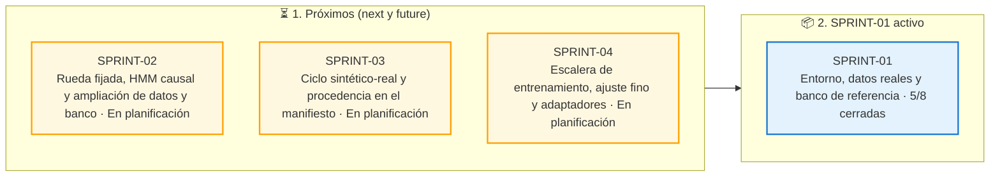

# Tablero de planes — quantdesk-model

Toda evolución sustancial se rige por un documento de plan antes de tocar código de producción. El
trabajo se organiza en sprints, gestionados por las skills globales `sprint`, `execute-plan` y
`como-vas`; los datos propios del proyecto están en [SPRINT_PROJECT.md](SPRINT_PROJECT.md).

## Convención

- **[current/](current/)**: sprint activo (`SPRINT.md`, planes de grupo, LAUNCH, USAGE, issues).
- **[next/](next/)**: el próximo sprint en preparación. Prepararlo no lo activa.
- **[future/](future/README.md)**: sprints posteriores, uno por carpeta (`future/SPRINT-NN/SPRINT.md`).
  Al activar next, `future/SPRINT-(n+1)` se promueve a next.
- **[backlog/](backlog/README.md)**: planes futuros sin sprint asignado.
- **[issues/](issues/index.md)**: incidencias vivas fuera de sprint ([plantilla](issues/TEMPLATE_ISSUE.md)).
- **[usage/](usage/README.md)**: registro global de cuota y costes ([protocolo](USAGE_PROTOCOL.md)); nunca se mueve.
- **[archive/](archive/index.md)**: dossier completo de cada sprint cerrado (`SPRINT-NN_<inicio>_<fin>/`).
- **[DEPENDENCIAS.md](DEPENDENCIAS.md)**: dependencias de nuestros sprints con sprints de otros
  proyectos; `/sprint deps` muestra el grafo y qué está listo para empezar.
- **[arnes/](arnes/README.md)**: arnés de ejecución y arranque de los relevos de la raíz.
- **[STATUS.md](STATUS.md)**: estado global vivo.

Ciclo: planificación → inicio → ejecución → cierre y archivo → freeze → release → planificación.

## Estado

| Fase | Sprint | Enlace |
|---|---|---|
| Activo | SPRINT-01 — Entorno, datos reales y banco de referencia (desde 2026-11-07) | [current/SPRINT.md](current/SPRINT.md) |
| Próximo | SPRINT-02 — Rueda fijada, HMM causal y ampliación de datos y banco (tras quantdesk SPRINT-02) | [next/SPRINT.md](next/SPRINT.md) |
| Futuros | SPRINT-03 (tras quantdesk SPRINT-03), SPRINT-04 (tras quantdesk SPRINT-04) | [future/](future/README.md) · [DEPENDENCIAS](DEPENDENCIAS.md) |
| Último cerrado | ninguno | [archive/](archive/index.md) |

## Backlog

| Plan | Ámbito | Estado | Descripción |
|---|---|---|---|
| [Backlog del laboratorio](backlog/README.md) | Tareas que se ejecutan aquí (TI-*, TS-00-*, TS-02-DISC, ejecuciones de entrenamiento) y calendario de todo | Repartido en SPRINT-01…04 | Antes en `docs/plans/BACKLOG.md` (ahora puntero). Especificación en los planes de `quantdesk` (sólo lectura) |

## 🧭 Tablero Kanban de Planes

Generado desde `docs/plans`: backlog, próximos sprints, sprint activo con el progreso de cada plan, sprints cerrados e issues abiertas.

<!-- kanban:inicio -->
<!-- Generado por `sprint_db.py kanban --write` (skill global sprint); no editar a mano: se regenera. -->

<!-- kanban:fin -->
