# Tablero de planes — quantdesk-model

Toda evolución sustancial se rige por un documento de plan antes de tocar código de producción. El
trabajo se organiza en sprints, gestionados por las skills globales `sprint`, `execute-plan` y
`como-vas`; los datos propios del proyecto están en [SPRINT_PROJECT.md](SPRINT_PROJECT.md).

## Convención

- **[current/](current/)**: sprint activo (`SPRINT.md`, planes de grupo, LAUNCH, USAGE, issues).
- **[next/](next/)**: el próximo sprint en preparación. Prepararlo no lo activa.
- **[future/](future/README.md)**: sprints posteriores, uno por carpeta (`future/SPRINT-NN/SPRINT.md`).
  Al activar next, `future/SPRINT-(n+1)` se promueve a next.
- **[backlog/](backlog/README.md)**: planes futuros sin sprint asignado.
- **[issues/](issues/index.md)**: incidencias vivas fuera de sprint ([plantilla](issues/TEMPLATE_ISSUE.md)).
- **[usage/](usage/README.md)**: registro global de cuota y costes ([protocolo](USAGE_PROTOCOL.md)); nunca se mueve.
- **[archive/](archive/index.md)**: dossier completo de cada sprint cerrado (`SPRINT-NN_<inicio>_<fin>/`).
- **[DEPENDENCIAS.md](DEPENDENCIAS.md)**: dependencias de nuestros sprints con sprints de otros
  proyectos; `/sprint deps` muestra el grafo y qué está listo para empezar.
- **[arnes/](arnes/README.md)**: arnés de ejecución y arranque de los relevos de la raíz.
- **[STATUS.md](STATUS.md)**: estado global vivo.

Ciclo: planificación → inicio → ejecución → cierre y archivo → freeze → release → planificación.

## Estado

| Fase | Sprint | Enlace |
|---|---|---|
| Activo | SPRINT-02 — Datos MT5 vía qn, FinCast y ampliación de datos (desde el 2026-11-11; partido por el usuario sin esperar a quantdesk SPRINT-02: filas 1b, 2b, 5, 6, 7) | [current/SPRINT.md](current/SPRINT.md) · [LAUNCH](current/LAUNCH.md) |
| Próximo | SPRINT-03 — Ciclo sintético-real y procedencia en el manifiesto, más las filas S02-1…S02-4 (rueda re-fijada, HMM causal, FG-16-hmmcop, universo59); tras quantdesk SPRINT-03 | [next/SPRINT.md](next/SPRINT.md) |
| Fuera de sprint, urgentes | Fichas vivas: ISSUE-TI12-MT5-SYNC, ISSUE-TI12-MT5-VELA-A-MEDIAS, ISSUE-TI12-MT5-INTRADIA-LOCAL, ISSUE-TI09-SONDA-CADENAS | [issues/](issues/index.md) |
| Futuros | SPRINT-04 (tras quantdesk SPRINT-04) | [future/](future/README.md) · [DEPENDENCIAS](DEPENDENCIAS.md) |
| Último cerrado | SPRINT-01 — Entorno, datos reales y banco de referencia (2026-11-07 a 2026-11-09), cerrado y archivado | [archive/SPRINT-01_2026-11-07_2026-11-09/SPRINT.md](archive/SPRINT-01_2026-11-07_2026-11-09/SPRINT.md) · [archive/](archive/index.md) |

## Backlog

| Plan | Ámbito | Estado | Descripción |
|---|---|---|---|
| [Backlog del laboratorio](backlog/README.md) | Índice, regla de separación, estado de las tareas ya en sprint (TS-00-*, TS-02-DISC, ejecuciones de entrenamiento) y calendario del laboratorio | SPRINT-01 cerrado (2026-11-09); lo pendiente en SPRINT-02…04 y en fichas fuera de sprint | Antes en `docs/plans/BACKLOG.md` (ahora puntero). Especificación en los planes de `quantdesk` (sólo lectura). Dividido el 2026-11-09 (usuario); puesto al día el 2026-11-10 con las decisiones de la revisión de planes (usuario, 2026-11-10) |
| [PLAN_ARCHIVO_OPCIONES](backlog/PLAN_ARCHIVO_OPCIONES.md) | TI-09-ARCH (parte laboratorio), TI-09-SONDA, retención (sin copia propia: copia común de network) | Backlog; sonda fuera de sprint (issue) | Lector del lago de `market.options.chain` con hash; espera a OC-03 del backend y unos 20 días hábiles de capturas, sin spot de respaldo (GAP-BACKLOG_README-01 resuelto, usuario, 2026-11-10) |
| [PLAN_DATOS_VIA_QN](backlog/PLAN_DATOS_VIA_QN.md) | TI-12-MT5 (fase C, intradía, INTRA-LOCAL, tarea programada, SYNC), TI-13-PUB (mercado público, movido al backend), TI-02-DATA-V2, TI-02-DIARIO | Fase C cerrada en SPRINT-01 (2026-11-09); INTRA-LOCAL y SYNC fuera de sprint (issues); TI-02-DATA-V2 en SPRINT-02 fila 1b; TI-02-DIARIO: el laboratorio escribe, el backend programa; resto backlog | Datos de mercado sólo por publicadores y consumo vía qn (A16 bis); Binance como corpus congelado |

## 🧭 Tablero Kanban de Planes

Generado desde `docs/plans`: backlog, próximos sprints, sprint activo con el progreso de cada plan, sprints cerrados e issues abiertas.

```mermaid
graph LR
    classDef backlog fill:#eceff1,stroke:#607d8b,stroke-width:2px;
    classDef next fill:#fff8e1,stroke:#ffa000,stroke-width:2px;
    classDef current fill:#e3f2fd,stroke:#1976d2,stroke-width:2px;
    classDef completed fill:#e8f5e9,stroke:#388e3c,stroke-width:2px;
    classDef issues fill:#fff3e0,stroke:#f57c00,stroke-width:2px;

    subgraph B["📌 1. Backlog (futuros)"]
        B1["PLAN_ARCHIVO_OPCIONES<br/>Archivo de cadenas de opciones del laboratorio (TI-09-ARCH)"]:::backlog
        B2["PLAN_DATOS_VIA_QN<br/>Datos de mercado vía qn (MT5, publicadores públicos, export…"]:::backlog
    end

    subgraph N["⏳ 2. Próximos (next y future)"]
        N1["SPRINT-03<br/>Ciclo sintético-real y procedencia en el manifiesto · En planificación"]:::next
        N2["SPRINT-04<br/>Escalera de entrenamiento, ajuste fino y adaptadores · En planificación"]:::next
    end

    subgraph C["📦 3. SPRINT-02 activo"]
        C1["SPRINT-02<br/>Datos MT5 vía qn, FinCast y ampliación de datos · 0/5 cerradas"]:::current
        C2["PLAN_DATOS_VIA_QN<br/>Datos de mercado vía qn (MT5, publicadores públicos, export…"]:::current
        C3["PLAN_ARCHIVO_OPCIONES<br/>Archivo de cadenas de opciones del laboratorio (TI-09-ARCH)"]:::current
        C1 --> C2
        C1 --> C3
    end

    subgraph D["✅ 4. Sprints cerrados"]
        D1["SPRINT-01<br/>Entorno, datos reales y banco de referencia · Cerrado"]:::completed
    end

    subgraph P["⚠️ 5. Issues abiertas"]
        P1["ISSUE-TI09-SONDA-CADENAS<br/>¿Hay cadenas de opciones en qn? Sonda de sólo lectura · Abierto"]:::issues
        P2["ISSUE-TI12-MT5-INTRADIA-LOCAL<br/>Guardar en local el 1m y 5m de MT5 antes de que el bróker l… · Abierto"]:::issues
        P3["ISSUE-TI12-MT5-SYNC<br/>Publicar el 1d de MT5 sólo con la historia sincronizada, po… · En resolución vía ISSUE-TI12-M"]:::issues
        P4["ISSUE-TI12-MT5-VELA-A-MEDIAS<br/>El publicador MT5 publicó la vela 1d del 2026-11-09 a media… · En resolución"]:::issues
        P5["ISSUE-LAGO-FX-1D-CLOSE<br/>El «close» del FX diario del lago (yfinance) es el precio d… · Abierto"]:::issues
    end

    B --> N
    N --> C
    C --> D
    D --> P

    click B1 href "https://github.com/makiolo/quantdesk-model/blob/main/docs/plans/backlog/PLAN_ARCHIVO_OPCIONES.md" _blank
    click B2 href "https://github.com/makiolo/quantdesk-model/blob/main/docs/plans/backlog/PLAN_DATOS_VIA_QN.md" _blank
    click N1 href "https://github.com/makiolo/quantdesk-model/blob/main/docs/plans/next/SPRINT.md" _blank
    click N2 href "https://github.com/makiolo/quantdesk-model/blob/main/docs/plans/future/SPRINT-04/SPRINT.md" _blank
    click C1 href "https://github.com/makiolo/quantdesk-model/blob/main/docs/plans/current/SPRINT.md" _blank
    click C2 href "https://github.com/makiolo/quantdesk-model/blob/main/docs/plans/backlog/PLAN_DATOS_VIA_QN.md" _blank
    click C3 href "https://github.com/makiolo/quantdesk-model/blob/main/docs/plans/backlog/PLAN_ARCHIVO_OPCIONES.md" _blank
    click D1 href "https://github.com/makiolo/quantdesk-model/blob/main/docs/plans/archive/SPRINT-01_2026-11-07_2026-11-09/SPRINT.md" _blank
    click P1 href "https://github.com/makiolo/quantdesk-model/blob/main/docs/plans/issues/ISSUE-TI09-SONDA-CADENAS.md" _blank
    click P2 href "https://github.com/makiolo/quantdesk-model/blob/main/docs/plans/issues/ISSUE-TI12-MT5-INTRADIA-LOCAL.md" _blank
    click P3 href "https://github.com/makiolo/quantdesk-model/blob/main/docs/plans/issues/ISSUE-TI12-MT5-SYNC.md" _blank
    click P4 href "https://github.com/makiolo/quantdesk-model/blob/main/docs/plans/issues/ISSUE-TI12-MT5-VELA-A-MEDIAS.md" _blank
    click P5 href "https://github.com/makiolo/quantdesk-model/blob/main/docs/plans/current/issues/ISSUE-LAGO-FX-1D-CLOSE.md" _blank
```

<!-- kanban:inicio -->
<!-- Generado por `sprint_db.py kanban --write` (skill global sprint); no editar a mano: se regenera. -->

Enlaces de los planes e issues

**📌 Backlog (futuros)**

- [PLAN_ARCHIVO_OPCIONES](backlog/PLAN_ARCHIVO_OPCIONES.md) — Archivo de cadenas de opciones del laboratorio (TI-09-ARCH)
- [PLAN_DATOS_VIA_QN](backlog/PLAN_DATOS_VIA_QN.md) — Datos de mercado vía qn (MT5, publicadores públicos, export…

**⏳ Próximos (next y future)**

- [SPRINT-03](next/SPRINT.md) — Ciclo sintético-real y procedencia en el manifiesto
- [SPRINT-04](future/SPRINT-04/SPRINT.md) — Escalera de entrenamiento, ajuste fino y adaptadores

**📦 SPRINT-02 activo**

- [SPRINT-02](current/SPRINT.md) — Datos MT5 vía qn, FinCast y ampliación de datos
  - [PLAN_DATOS_VIA_QN](backlog/PLAN_DATOS_VIA_QN.md) — Datos de mercado vía qn (MT5, publicadores públicos, export…
  - [PLAN_ARCHIVO_OPCIONES](backlog/PLAN_ARCHIVO_OPCIONES.md) — Archivo de cadenas de opciones del laboratorio (TI-09-ARCH)

**✅ Sprints cerrados**

- [SPRINT-01](archive/SPRINT-01_2026-11-07_2026-11-09/SPRINT.md) — Entorno, datos reales y banco de referencia

**⚠️ Issues abiertas**

- [ISSUE-TI09-SONDA-CADENAS](issues/ISSUE-TI09-SONDA-CADENAS.md) — ¿Hay cadenas de opciones en qn? Sonda de sólo lectura
- [ISSUE-TI12-MT5-INTRADIA-LOCAL](issues/ISSUE-TI12-MT5-INTRADIA-LOCAL.md) — Guardar en local el 1m y 5m de MT5 antes de que el bróker l…
- [ISSUE-TI12-MT5-SYNC](issues/ISSUE-TI12-MT5-SYNC.md) — Publicar el 1d de MT5 sólo con la historia sincronizada, po…
- [ISSUE-TI12-MT5-VELA-A-MEDIAS](issues/ISSUE-TI12-MT5-VELA-A-MEDIAS.md) — El publicador MT5 publicó la vela 1d del 2026-11-09 a media…
- [ISSUE-LAGO-FX-1D-CLOSE](current/issues/ISSUE-LAGO-FX-1D-CLOSE.md) — El «close» del FX diario del lago (yfinance) es el precio d…

<!-- kanban:fin -->
